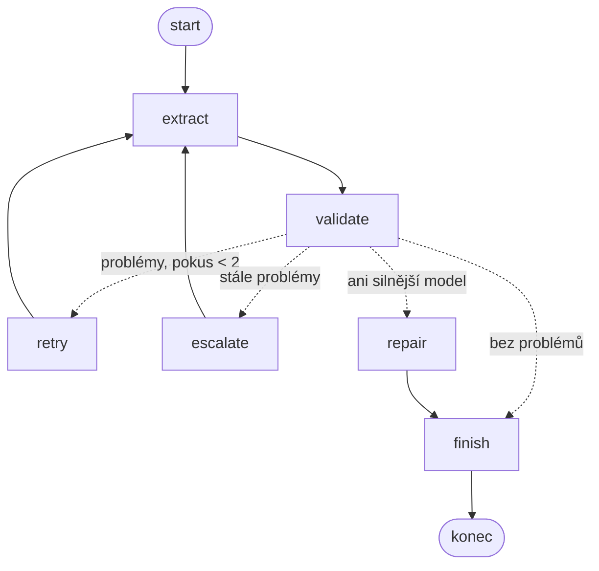

# 🍺 Pivo v akci

Jednoduchá webová aplikace, která hlídá akční ceny piva v českých supermarketech
(Kaufland, Lidl, Penny, Albert, Billa, Tesco, Globus, COOP) a zobrazuje je
seřazené od nejlevnějšího – s obchodem a platností akce.
Běží na https://levne.pitpivo.cz/.

## Jak to funguje

1. **Scraper** (`scraper/scrape.py` + `scraper/chains/`) jednou denně stáhne
   akce přímo z webů řetězců a uloží je do `data/pivo.json`. Denní snapshoty
   se archivují v `data/history/` (porovnání pro upozornění, analýza toho,
   kdy řetězce akce zavádějí).
   - **Albert, Lidl a Tesco** zveřejňují akce piva jen v letácích – stránky
     letáků se vyrenderují a akční piva z nich vytáhne **Claude API
     (Claude Haiku 5.5)** se strukturovaným JSON výstupem
     (`scraper/chains/leaflet_ai.py`). Výsledky se cachují podle ID letáku
     (`data/cache/<řetězec>/`), API se tak volá jen pro nové letáky
     (řádově jednotky Kč týdně).
   - Každou stránku letáku zpracuje **LangGraph pipeline**
     (`scraper/chains/leaflet_graph.py`), viz níže.
   - **Záložní zdroj** (`scraper/fallback.py`) doplňuje řetězce bez
     použitelného přímého zdroje (Penny, COOP) a zastupuje řetězec, jehož
     přímý scraper selže. Jeho implementace není součástí repozitáře; bez ní
     web zobrazuje jen přímá data.
   - Akce vázané na prodejny nesou poznámku o dostupnosti
     („dostupné pouze: …", „jen hypermarkety").
2. **GitHub Actions** (`.github/workflows/update.yml`) spouští scraper každé
   ráno a web nasadí přes FTP (lftp) na hosting.
3. **Web** (`index.html`) je statická stránka – načte JSON a zobrazí seznam
   s filtrem podle obchodu a značky, hledáním a řazením (Kč/litr nebo Kč/kus,
   klik na aktivní řazení obrátí směr).
4. **E-mailová upozornění** (`api/` + `scraper/send_digest.py`) – návštěvník
   si na webu vybere řetězce a značky a zadá e-mail.
   - PHP API na hostingu (SQLite v `api/data/`, mimo web přes .htaccess)
     řeší double opt-in: nový odběr i změna nastavení platí až po kliknutí
     na potvrzovací odkaz (7 dní, pak se nepotvrzené záznamy mažou).
     Odhlášení odkazem z každého e-mailu adresu smaže (podporuje i one-click
     odhlášení poštovních klientů).
   - Rozesílání běží v Actions po scrapingu: porovná dnešní data s posledním
     snapshotem, nové akce spáruje s preferencemi odběratelů (z
     `api/export.php`, chráněno tokenem v hlavičce) a pošle přes SMTP.
     E-mail odejde jen tomu, pro koho je něco nového, nejvýš 1× denně.
   - Seznam značek je v `scraper/chains/brands.py` a duplicitně
     v `index.html` (BRAND_PATTERNS) – při změně upravit obojí.

## Zdroje dat řetězců

| Řetězec  | Zdroj | Dostupnost akcí |
|----------|-------|-----------------|
| Kaufland | SSR JSON z prodejny.kaufland.cz, celostátní seznam akcí | celostátní |
| Lidl     | akční letáky (API letáků; do Claude API jdou jen stránky, kde OCR text zmiňuje pivo) + online katalog lidl.cz | celostátní |
| Billa    | product-discovery API billa.cz, kategorie Pivo (bez platnosti akcí) | celostátní |
| Tesco    | PDF letáky (aktuální + příští týden, verze HM a SM) → Claude API | podle formátu („jen hypermarkety/supermarkety") |
| Globus   | interní API, všech 16 hypermarketů | podle prodejny („dostupné pouze: …") |
| Albert   | PDF letáky (Publitas) → Claude API, cache per leták | podle formátu („jen hypermarkety/supermarkety") |
| Penny    | záložní zdroj (web penny.cz publikuje jen výběr akcí; modul `penny.py` je k dispozici) | – |
| COOP     | záložní zdroj (síť regionálních Jednot nemá celostátní zdroj; modul `coop.py` pro leták Terno ČB je k dispozici) | – |

Prodejnové nabídky (Kaufland, Tesco, Globus, COOP) se vážou na lokalitu
`LOCALITY` v `scraper/chains/common.py`.

## Vytěžování letáků: LangGraph pipeline

Jedno volání modelu občas přečte cenu špatně (cena za kus vs. za balení,
cena za litr od jiné nabídky, původní cena nižší než akční). Stránka
letáku proto prochází grafem, který výsledek kontroluje a opravuje:



- **extract**: Claude Haiku 5.5 vrátí nabídky jako strukturovaný JSON.
- **validate**: deterministická pravidla bez volání modelu: rozsah ceny,
  cena za litr odpovídá ceně a objemu (tolerance 12 %), původní cena je
  vyšší než akční, platnost od ≤ do.
- **retry**: model dostane svou předchozí odpověď a seznam problémů
  a odpoví znovu.
- **escalate**: jeden pokus silnějším modelem (`LEAFLET_STRONG_MODEL`,
  výchozí `claude-sonnet-5-5`, prázdná hodnota eskalaci vypne).
- **repair**: co se neopravilo, opraví pravidla (nesmyslná cena → nabídka
  zahozena, nesedící cena za litr → dopočítá se z objemu) a zapíše se do
  fronty k ruční kontrole `data/review/<datum>.json`.

Stránka bez problémů stojí jedno volání jako dřív, nejhorší případ jsou
3 volání. Na konci běhu scraper vypíše volání a tokeny podle modelu.
`LEAFLET_PIPELINE=legacy` vrátí původní jedno volání bez kontroly.

### Evaluace

Zlatá sada jsou ručně ověřené stránky letáků v `scraper/eval/golden/`
(obrázky jen lokálně, popisky `.json` v repozitáři).

```bash
pip install -r scraper/requirements-dev.txt
python scraper/eval/build_golden.py --albert --max-pages 30  # návrhy od silnějšího modelu
# zkontrolovat a opravit golden/*.json proti obrázkům, nastavit "verified": true
python scraper/eval/run_eval.py          # legacy vs. graph: precision, recall,
                                         # shoda polí, volání a tokeny
pytest scraper/tests                     # větvení grafu s falešným klientem, bez API
```

## Lokální spuštění

```bash
pip install -r scraper/requirements.txt
export ANTHROPIC_API_KEY=...      # volitelné – bez něj jdou Albert/Lidl/Tesco ze zálohy
python scraper/scrape.py          # -> data/pivo.json
python -m http.server 8000        # otevřít http://localhost:8000
```

API odběrů vyžaduje PHP 8 s `pdo_sqlite`; konfigurace podle
`api/config.example.php` (na hostingu ji generuje deploy).

## Konfigurace GitHub Actions

Secrets (Settings → Secrets and variables → Actions → Secrets):

| Secret | Účel |
|--------|------|
| FTP_HOST, FTP_USERNAME, FTP_PASSWORD, FTP_REMOTE_DIR | nasazení na hosting |
| PROXY_URL | volitelná proxy pro scraping (některé weby blokují IP GitHub Actions) |
| ANTHROPIC_API_KEY | extrakce letáků (Albert, Lidl, Tesco) přes Claude API |
| FALLBACK_SOURCE_B64 | volitelný záložní zdroj (base64 souboru `scraper/private/fallback_source.py`) |
| SMTP_HOST, SMTP_PORT, SMTP_USER, SMTP_PASS | odesílání upozornění (465 = SSL, jinak STARTTLS) |
| EXPORT_TOKEN | tajný token (min. 32 znaků) pro `api/export.php`; deploy z něj generuje `api/config.php` |

Variables (záložka Variables – nejsou tajné):

| Variable | Účel |
|----------|------|
| SITE_URL | veřejná adresa webu, např. `https://levne.pitpivo.cz` |
| MAIL_FROM | odesílatel upozornění (výchozí = SMTP_USER) |

Bez SMTP/EXPORT_TOKEN/SITE_URL se krok rozesílání jen přeskočí.

## Poznámky

- Aktualizace: 1× denně (cron v GitHub Actions, ~4–5 h ráno; GitHub
  naplánované běhy občas zpožďuje), lze spustit i ručně přes
  Actions → Run workflow.
- Logy Actions jsou u veřejného repozitáře veřejné – skripty nevypisují
  e-mailové adresy ani tajné hodnoty.
- Data pocházejí z veřejně dostupných letáků a webů. Projekt je nekomerční,
  scrapery se dotazují šetrně (1 dávka denně, s prodlevami).

## Licence

Kód je pod licencí MIT (viz `LICENSE`).
